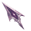
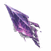
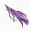
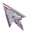
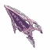
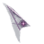

# Ayarime — six cursor concepts

These six transparent 64 × 64 PNG prototypes were extracted from the **original six-design AYARIME CURSOR CONCEPTS sheet** created in the project conversation on 4 November 2026.

They deliberately preserve the artwork's six identities:

| Concept | Image |
| --- | --- |
| 01 — Classic Spearhead |  |
| 02 — Crystal-Tech Shard |  |
| 03 — Elven Feather |  |
| 04 — Hollow Frame |  |
| 05 — Rune-Edged |  |
| 06 — Minimal Precision |  |

## Current integration

**Station Configuration → Pointer Design** provides an opt-in choice of the six designs, plus **System Default** (the default).

The selected design is stored in a dedicated ELF//SHELL workspace field, included in configuration backup/import, and synchronised across open ELF//SHELL new-tab pages. Cursor paths are strictly allowlisted—no arbitrary filesystem or URL values are imported.

The pointer is **only applied to the ELF//SHELL dashboard**. Firefox's address bar, native context menus, other websites, and the Linux Mint system pointer remain unchanged. On dashboard inputs/textarea, the normal I-beam text cursor is preserved.

## Design and QA status

- Original artwork → foreground-masked, palette-optimised transparent PNGs. These are **prototypes**, not a pixel-perfect vector trace; source art can be reworked after visual review.
- 64 × 64 with a top-left 2 × 2 hotspot for every design; this is an initial alignment subject to live Firefox and high-DPI testing.
- Verify under 100%, 150%, 200% display scaling, with left/right mouse handedness and high-contrast system settings.
- Browser cursor size support may differ by platform; the final theme can include 32/48-pixel versions if necessary.
- No OS-wide theme installer or persistent cursor changes to Linux Mint are made.

All assets are local: no runtime downloads, external image hosts, telemetry, or remote assets.
